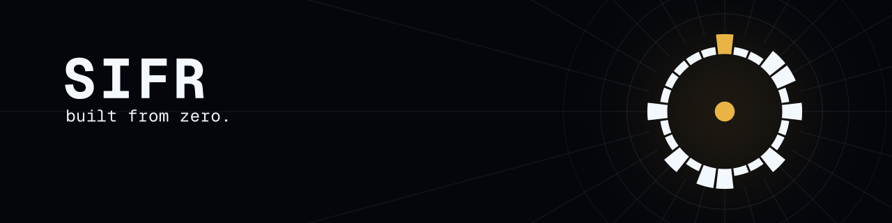

# Evidence record

## 2026-11-16 — RMSNorm reference vs Triton fused (`bench/compare_rmsnorm.py`)

Hardware: NVIDIA GeForce RTX 4060 Laptop GPU (capability 8.9, 7.66 GiB), driver 620.70.06, Linux 7.3.4-zen2-2-zen.

Stack: torch 2.15.0+cu132, triton 3.9, Python 3.12.16, `sifr-ml-systems==0.1.0` (editable).

Protocol: 10 warmup iterations, 100 timed iterations, CUDA events, median reported. Command: `python bench/compare_rmsnorm.py --rows <R> --cols 4096 --dtype <T>`.

| Shape | dtype | reference | Triton fused | speedup |
|---|---|---:|---:|---:|
| 4096 × 4096 | float16 | 3.4365 ms | 0.3164 ms | ≈ 10.9× |
| 8192 × 4096 | float32 | 4.1687 ms | 1.2025 ms | ≈ 3.5× |

Correctness: `pytest -q` → **5 passed** (2026-11-16), including `test_rmsnorm_triton_matches_reference` (CUDA-gated, rtol/atol 2e-3 on float16 inputs).

Scope of evidence: single GPU, single kernel, one shape/dtype pair per run; not a general claim about arbitrary transformer workloads. Re-run the command above to reproduce. The Triton default-FP-fusion warning is recorded; results were produced with Triton defaults.

Method note: wall timings from CUDA events capture kernel time only (not full forward/backward training step time).

## 2026-11-16 (update) — RMSNorm: four-backend comparison (`bench/compare_rmsnorm.py --backend all`)

Hardware/stack identical to above. Backend list added: `reference` (torch, unfused), `triton_fused` (hand-written Triton), `torch_compile` (Inductor), `jax_jit` (XLA). JAX arrays were zero-copy `jax.dlpack.from_dlpack` views of the torch tensors; GPU-only; JIT compilation occurred inside warm-up (10 iterations), not in the timed loop.

| Shape | dtype | reference | Triton fused | torch.compile | JAX jit |
|---|---|---:|---:|---:|---:|
| 4096 × 4096 | float16 | 3.360 ms | 0.311 ms | 0.318 ms | **0.147 ms** |
| 8192 × 4096 | float32 | 4.078 ms | 1.203 ms | 1.215 ms | **0.173 ms** |

Speedups vs the torch reference (same commands, same machine):

| Shape | dtype | Triton | torch.compile | JAX jit |
|---|---|---:|---:|---:|
| 4096 × 4096 | float16 | ≈ 10.8× | ≈ 10.6× | ≈ 22.8× |
| 8192 × 4096 | float32 | ≈ 3.4× | ≈ 3.4× | ≈ 23.6× |

Measured, not asserted: XLA's generated kernel beat the hand-written Triton kernel on both configurations. Likely causes are XLA's layout/vectorization choices for the normalize+rsqrt sequence and absence of extra memory traffic the Triton kernel does not eliminate; no claim is made that either would generalize to arbitrary norm shapes without re-measurement. This is also the honest outcome of "which backend wins on this GPU for this shape?" — the evidence is the benchmark, not the narrative.

Correctness after the change: `pytest -q` → **18 passed** (was 5). New parity suite `tests/test_rmsnorm_parity.py` covers fp32 (1e-5), fp16 and bf16 (2e-2), for Triton, torch.compile, JAX un-jitted and JAX jitted, plus a Triton-vs-JAX cross-check. JAX tests require a CUDA-capable JAX (`jax.devices()` with a CUDA platform) and skip cleanly otherwise.

Commands: `python -m bench.compare_rmsnorm --rows 4096 --cols 4096 --dtype float16 --backend all` and the fp32 variant above. Re-run to reproduce; values are medians of 100 iterations after 10 warm-ups on the same machine.
