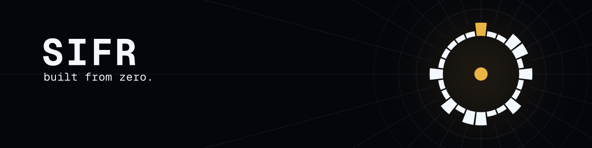

# sifr-ml-systems

Hardware-aware machine-learning systems engineering. The project studies and implements computation below the high-level framework interface: GPU kernels, memory movement, numerical correctness, and measured performance — with reproducible evidence rather than wrapper demos.

## Scope and honesty boundaries

- Correctness is defined by executable tests, not by narrative.
- Benchmarks are reproducible commands with warmup, medians, and explicit hardware/driver reporting.
- GPU claims are only made when the relevant path actually runs on the target GPU. GPU-specific tests skip cleanly on machines without CUDA.
- This is a young project: it now contains two working, reference-tested fused kernels (RMSNorm, fused attention) compared across torch, Triton, torch.compile, JAX and SDPA. It is not a complete training framework. On this GPU and these shapes, the JAX/XLA path was measured fastest for RMSNorm and PyTorch's fused SDPA leads on causal attention; see `EVIDENCE.md`.

## What exists today

| Component | State |
|---|---|
| `sifr_ml_systems.kernels.rmsnorm` | Reference RMSNorm with matching manual-formula test |
| `sifr_ml_systems.kernels.rmsnorm_triton` | Fused Triton kernel, one program per row, single pass |
| `sifr_ml_systems.kernels.rmsnorm_jax` | JAX reference (`rmsnorm_jax`) and `rmsnorm_jax_jit` (XLA-compiled) |
| `sifr_ml_systems.kernels.rmsnorm_torch` | `torch.compile`'d reference baseline |
| `sifr_ml_systems.bench` | CUDA-event benchmark harness (warmup, median) |
| `bench/compare_rmsnorm.py` | Reproducible four-backend comparison (`--backend all`) |
| `tests/test_rmsnorm_parity.py` | fp32/fp16/bf16 parity: Triton vs reference vs torch.compile vs JAX |
| `sifr_ml_systems.kernels.attention_triton` | FlashAttention-2-style fused attention forward (online softmax, causal support) |
| `bench/compare_attention.py` | Reproducible attention comparison (`--backend all`) |
| `tests/test_attention_parity.py` | fp32/fp16/bf16 parity × causal × shapes: Triton vs reference vs SDPA |

## Environment

- Linux, Python 3.12, PyTorch 2.15.
- GPU path: NVIDIA driver + CUDA-enabled PyTorch (benchmarked on an RTX 4060).
- CPU-only machines run the reference tests; the fused kernel test skips cleanly.

## Install

```bash
python3.12 -m venv .venv
. .venv/bin/activate
pip install -e .
```

## Run correctness tests

```bash
pytest -q
```

## Run the RMSNorm benchmark

```bash
python bench/compare_rmsnorm.py --rows 4096 --cols 4096 --dtype float16 --backend all
```

On CPU, only the reference path is timed; the fused kernel requires CUDA and Triton.

## Roadmap (unscripted — recorded as it actually happens)

- [x] RMSNorm: reference + Triton fused kernel, CPU correctness test, CUDA-gated parity test
- [x] Verified RTX 4060 timings (see `EVIDENCE.md`, 2026-11-16)
- [x] JAX 0.12.0.1 + CUDA 13 plugin recognized the GPU (`CudaDevice(id=0)`)
- [x] JAX reference path for the same kernel semantics (`rmsnorm_jax`, `rmsnorm_jax_jit`)
- [x] Cross-implementation parity tests (Triton / torch.compile / JAX vs reference) — 2026-11-16, `pytest -q` 18 passed
- [x] Four-backend benchmark recorded with reproduction commands (`EVIDENCE.md`, 2026-11-16)
- [x] Fused attention (FlashAttention-2-style online softmax, causal support) vs naive reference and SDPA — `EVIDENCE.md`, 2026-11-16
- [ ] cuBLAS `torch.compile` vs hand-written Triton reductions
- [ ] BF16 vs FP32 precision/throughput surface

## License

No license declared yet. The owner will select one before public release.
